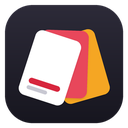
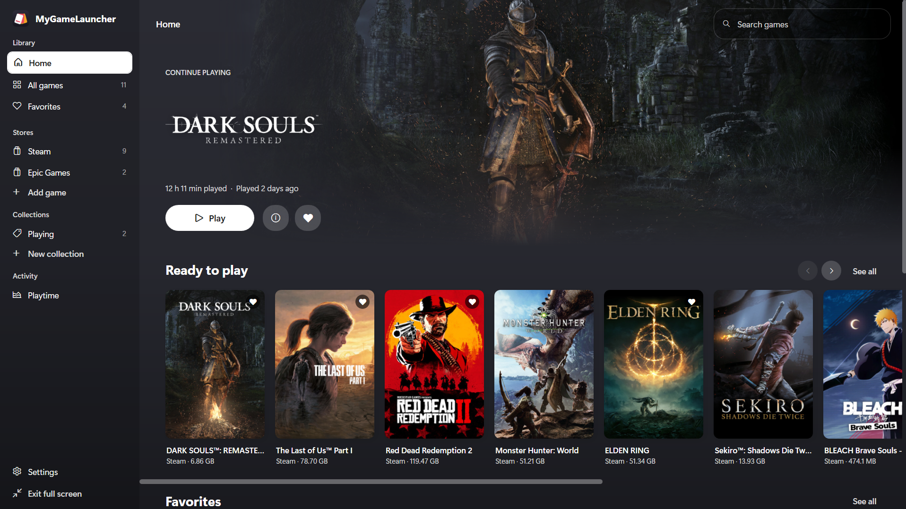
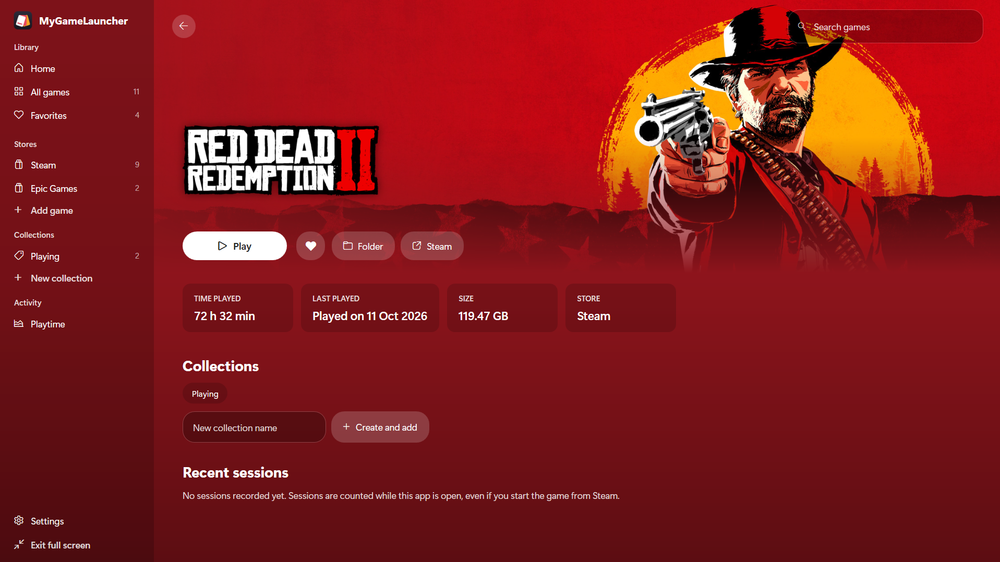
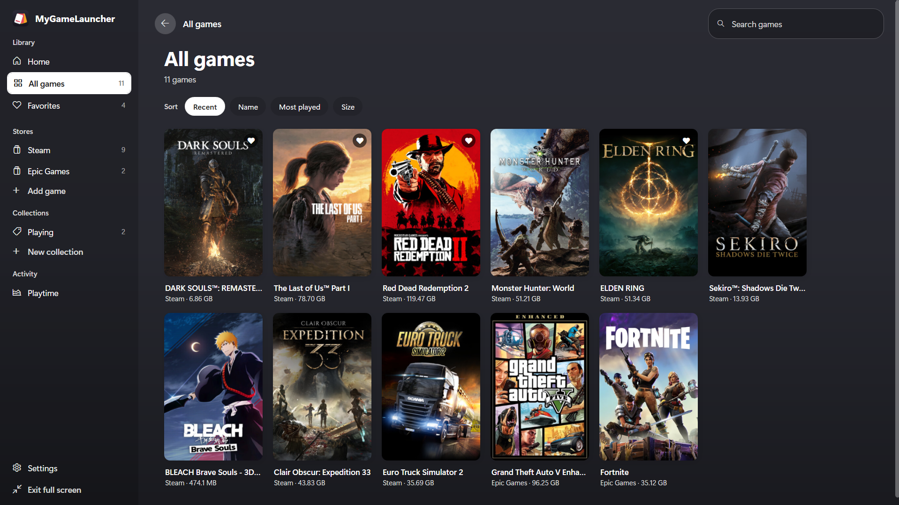
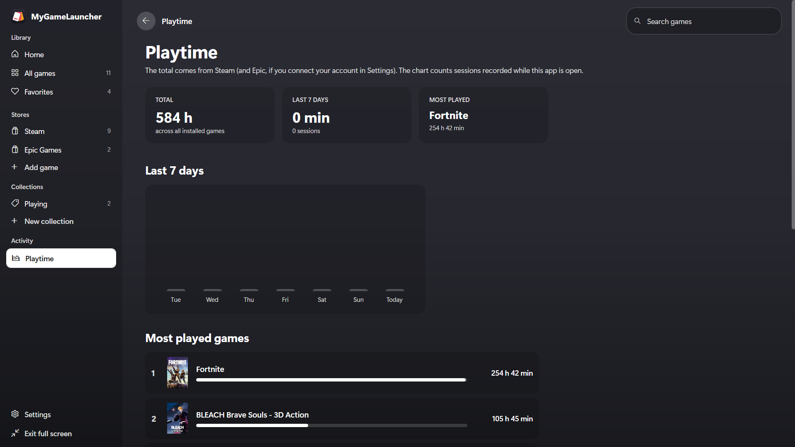

<p align="center">
  
</p>

<h1 align="center">MyGameLauncher</h1>

<p align="center">One library for all your PC games — Steam, Epic Games, Ubisoft Connect and anything else.</p>

<p align="center">
  <a href="../../releases/latest"><b>⬇ Download the latest version</b></a>
</p>

<p align="center">
  
</p>

---

## Features

- **All your stores in one place** — finds games installed with **Steam**, **Epic Games** and **Ubisoft Connect** automatically (no duplicates), and lets you **add any other game or launcher by hand** (Battle.net, EA app, GOG, …).
- **Console-style home screen** — a big "Continue playing" banner, rows for recent games, favorites and your collections.
- **Colors that follow the game** — the whole app takes the color of the featured game's cover.
- **Playtime** — total hours read from Steam (and from Epic, if you choose to connect your account), plus a 7-day chart and a most-played ranking.
- **Favorites, collections, search, sorting and store filters.**
- **Controller support** — Xbox and PlayStation (DualShock 4 / DualSense, USB or Bluetooth, no extra software), with a Big Picture-style hint bar that shows the right button icons.
- **Full screen mode** for the TV (F11 or the Menu/Options button).
- **5 languages** — English, Português, Español, Français, Deutsch (uses your Windows language when available).

## Screenshots

<table>
  <tr>
    <td width="50%"><p align="center"><sub>Game page — the colors follow the game</sub></p></td>
    <td width="50%"><p align="center"><sub>Your whole library, from every store</sub></p></td>
  </tr>
  <tr>
    <td width="50%"><p align="center"><sub>Playtime from Steam and Epic</sub></p></td>
    <td width="50%"><p align="center"><sub>Console-style home screen</sub></p></td>
  </tr>
</table>

## Download

Get the latest installer from the **[Releases](../../releases)** page and run `MyGameLauncher-Setup-x.y.z.exe`.

- Windows 10 or 11 (64-bit). Nothing else to install — .NET is included.
- The installer isn't digitally signed yet, so Windows SmartScreen may warn you: click **More info → Run anyway**.

## Optional settings

- **SteamGridDB key** (Settings) — used to find covers for games that Steam doesn't have artwork for (Epic, Ubisoft and games you add by hand). Get a free key at [steamgriddb.com](https://www.steamgriddb.com/profile/preferences/api).
- **Epic Games account** (Settings) — only used to read playtime of your Epic games. Sign-in happens on Epic's website (the app never sees your password), the authorization is stored encrypted on your PC only, and you can disconnect at any time. This uses the same unofficial connection as Legendary / Heroic Games Launcher.

## Building from source

Requirements: [.NET 10 SDK](https://dotnet.microsoft.com/download/dotnet/10.0) on Windows.

```
dotnet run                          # run the app
dotnet publish -c Release -o out    # single MyGameLauncher.exe with .NET included
```

To build the installer, install [Inno Setup 6](https://jrsoftware.org/isdl.php) and double-click `criar-instalador.bat`. The installer is written to `installer\Output`.

Project layout: `Scanners/` (store detection), `Services/` (state, artwork, playtime tracking, controllers, Epic account), `Views/` (pages), `Localization/Loc.cs` (all texts in every language).

## Credits

- Game artwork: Steam (© Valve and the game publishers) and community art from [SteamGridDB](https://www.steamgriddb.com).
- PlayStation controller input: [HidSharp](http://www.zer7.com/software/hidsharp) by James F. Bellinger (Apache 2.0).
- Button icon style inspired by [Zacksly](https://zacksly.itch.io)'s button icon packs (CC BY).
- Built with .NET and WPF (MIT).

Full third-party notices: [THIRD-PARTY-NOTICES.txt](THIRD-PARTY-NOTICES.txt).

Steam, Epic Games, Ubisoft Connect, Xbox, PlayStation, DualShock and DualSense are trademarks of their respective owners. MyGameLauncher is not affiliated with or endorsed by any of these companies.

## License

[MIT](LICENSE) © 2026 diog0_h
